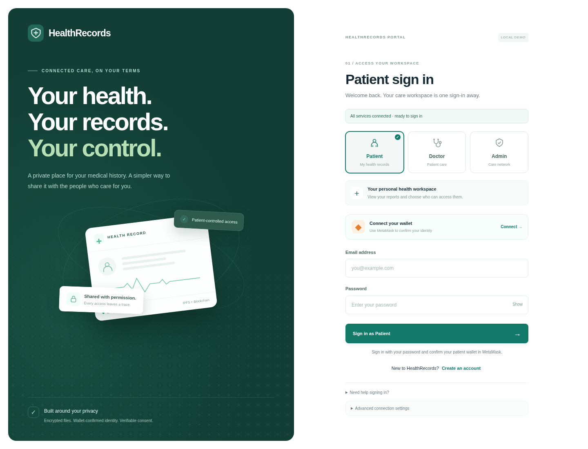

# HealthRecords

A complete local development app for wallet-bound Patient, Doctor and Administrator accounts, encrypted IPFS medical reports, and on-chain consent. Version **3.1.0** uses the green HealthRecords theme throughout the login, wallet dialog, and role dashboards.



## Update from the blue version

Download the latest project ZIP from GitHub. For an already working installation of the completed project, copy the ZIP's **frontend** folder into your existing project folder and replace the older frontend files. Refresh the browser with **Ctrl+F5**. The updated HTML requests versioned assets so the browser loads the green stylesheet.

Keep your existing backend configuration, database, encryption key and IPFS store. The web server can remain running while these frontend files are replaced. For a new installation, follow the startup instructions below from the newly extracted project directory.

## Start

Install **Python 3.12** and **Node.js 22 or 24** with npm. From this project directory:

```sh
npm run setup
npm run dev
```

Setup installs the locked Python/Node dependencies, verifies the official Kubo download with SHA-512, builds the Solidity contract, and creates an encryption key only for a new empty store. Start launches a local Hardhat chain, deploys the contract, starts a private offline IPFS node, and serves the website and API together on **port 5500**. Open your browser at the loopback address on port 5500 using the same hostname throughout. Keep the terminal open. Ctrl+C stops only the processes this command created.

On Windows you can also double-click `START_PROJECT.cmd`. The Python implementation is validated on Linux; the Windows wrapper has not been executed here.

## Connect MetaMask

1. Install and unlock the MetaMask browser extension. Click **Connect your wallet → MetaMask** on the site.
2. Approve account sharing and the **Hardhat Local** network request (chain ID **31337**, currency **ETH**). The app supplies its own `/rpc` address. If an existing network uses a different machine's RPC, edit it to the address shown under **Advanced connection settings → Wallet RPC**.
3. Use funded **local test accounts**, with a different wallet for each role. To see Hardhat's standard development accounts, start `npm run chain` in a separate terminal before `npm run dev`; the app reuses that node. Import an account into MetaMask through MetaMask's own account controls. These public test accounts must never hold real funds. HealthRecords never requests a private key or recovery phrase.
4. Click **Continue to sign in**, select a role, then **Create an account**. Enter a name, unique email, and password of at least 12 characters. Confirm the authentication message in MetaMask.

The contract deployer (Hardhat account #0) is the only administrator. Account #1 can be the patient and account #2 the doctor. There are no seeded application accounts or passwords.

## Complete the workflow

- **Administrator:** register with the deployer wallet, then approve the doctor's registration in the provider directory. Approval requires a wallet-confirmed transaction.
- **Doctor:** register with a separate wallet. After verification, request access using the patient's wallet address. The patient sees the request and can approve or decline it.
- **Patient:** upload a synthetic report; confirm its blockchain hash transaction. The API verifies the hash, encrypts the file, pins ciphertext in IPFS, and lists the report. Download your own reports, approve/decline requests, grant access directly, revoke access, or flag emergency access for review.
- **Doctor:** find shared reports and click **Log & download**. The download needs active consent (or emergency access) plus a fresh confirmed on-chain access receipt. Revocation immediately blocks API access. Emergency grants last 24 hours and are audited.

Switching wallets or networks signs out the current account. The app restores a valid session after refresh only when the same wallet is connected. The login screen reports actual service availability; it does not simulate an IPFS or wallet connection.

## Validation

```sh
npm run build
npm test
npm run test:browser
python scripts/dev.py --check --no-browser
```

Browser tests use an installed Chromium when available. Otherwise run `npx playwright install chromium` first, or set `PLAYWRIGHT_CHROMIUM_EXECUTABLE` to a compatible Chromium executable. Stop the development server before running browser tests: they launch an isolated API database on the same ports. The browser tests use EIP-1193/EIP-6963 test providers with real signatures and real local blockchain/IPFS operations. They do not automate the MetaMask extension UI. See `VALIDATION.md` for the recorded results.

## Local data and configuration

- `backend/.env`: locally generated encryption key and settings. Keep the original key whenever reports already exist.
- `backend/data/`: SQLite accounts, sessions, and report metadata.
- `.local/ipfs/`: pinned encrypted objects and Kubo state. The node runs offline; it does not publish reports to public IPFS peers.
- `.local/deployment.json`: current local contract address and administrator wallet.
- `.local/*.log`: service logs. Hardhat logs include public local-test account keys.

These paths and dependencies are ignored by Git and excluded from the delivery ZIP. Back up the database, encryption key, IPFS store and relevant blockchain state together.

**Hardhat is an ephemeral development chain.** Stopping/restarting the chain removes its records and consent. The launcher redeploys automatically and old-chain sessions/reports are kept separate; user accounts remain in SQLite, and doctors need verification again. Keep the chain running when restarting the site if you need to retain the current demo's records. This implementation is a development demonstration, not a hosted production medical-record service.

## Cloud use

The app uses same-origin `/api` and a restricted `/rpc` relay, so the frontend does not point at a user's own computer for its API. For an externally hosted development instance, set `HEALTHRECORDS_PUBLIC_URL` to its exact HTTPS origin, set `COOKIE_SECURE=true`, and start with `npm run dev -- --host 0.0.0.0 --no-browser` behind your authenticated HTTPS ingress. MetaMask must be able to reach the site's `/rpc` endpoint. Never expose Hardhat's port 8545 or Kubo's administration port 5001 directly. Hosting/ingress is not included or published by this project.

`npm run dev -- --port 5501` selects a different website port. Shared service ports remain 8545 (blockchain) and 5001 (IPFS). The relay permits only read methods and wallet-signed raw transactions, blocking unlocked account transactions and Hardhat administration methods. It is available only for development chain 31337.

The ZIP's original `Apply-Update.ps1`, `CONNECT_IPFS.cmd` and `Connect-IPFS.ps1` are retained for reference to the earlier Windows update workflow; they are not needed by the complete-project setup. `SHA256SUMS.json` belongs to the original uploaded archive and is not a manifest for this revised source tree.
